# 🌱 Awesome ESG & Sustainability Management

<p align="center">
  
</p>

<p align="center">
  <a href="https://github.com/ishandutta2007/Awesome-Awesome-Awesome"></a><a href="https://discord.gg/jc4xtF58Ve"></a>
  <a href="https://github.com/ishandutta2007/Awesome-Esg-Sustainability-Management/stargazers"></a>
  <a href="https://github.com/ishandutta2007/Awesome-Esg-Sustainability-Management/network/members"></a>
  <a href="https://github.com/ishandutta2007/Awesome-Esg-Sustainability-Management/pulls"></a>
  <a href="https://opensource.org/licenses/MIT"></a>
  <a href="https://github.co//ishandutta2007"></a>
</p>

---

## 📌 Executive Summary & Ecosystem Guide

Welcome to the definitive, SEO-indexed directory of **ESG (Environmental, Social, and Governance) & Sustainability Management Software**. This curated index brings together leading commercial **SaaS platforms** and production-grade **open-source tooling** engineered for:

- 🌿 **Greenhouse Gas (GHG) Protocol Accounting**: Measure Scope 1 (direct), Scope 2 (indirect energy), and Scope 3 (upstream & downstream value chain) emissions.
- 📋 **Regulatory CSRD & ESRS Compliance**: End-to-end support for the EU Corporate Sustainability Reporting Directive (CSRD), European Sustainability Reporting Standards (ESRS), SEC climate disclosure rules, and California SB 253 / SB 261 mandates.
- 📉 **Science-Based Decarbonization**: Transition planning aligned with the Science Based Targets initiative (SBTi), Net Zero roadmaps, and Marginal Abatement Cost Curves (MACC).
- 🔍 **Audit-Ready ESG Data Lakes & LCA**: Transparent calculation engines, double materiality assessments, Life Cycle Assessment (LCA), and federated data retention for independent financial and ESG auditors.

---

## 📑 Table of Contents

- [📊 Sector Overview & Market Dynamics](#-sector-overview--market-dynamics)
- [🏢 Enterprise SaaS & Hosted Platforms](#-enterprise-saas--hosted-platforms)
- [💻 Open-Source GitHub Projects](#-open-source-github-projects)
- [🏗️ Recommended Architecture Combinations](#️-recommended-architecture-combinations)
- [🤝 How to Contribute](#-how-to-contribute)
- [⭐ Star History](#-star-history)
- [💖 Support & Sponsoring](#-support--sponsoring)
- [⚖️ Disclaimer](#️-disclaimer)

---

## 📊 Sector Overview & Market Dynamics

The global **ESG & Sustainability Management Software market** is estimated at **$1.8 billion to $2.4 billion in 2026**, projected to surpass **$6.5 billion by 2032** with a rapid compound annual growth rate (CAGR) of ~19.5%. This exponential growth is propelled by stringent regulatory compliance mandates—most notably the European Union's Corporate Sustainability Reporting Directive (CSRD), California Senate Bills 253 and 261, PCAF disclosure mandates for financial institutions, and IFRS/ISSB global baseline sustainability reporting standards.

Currently, the sector demonstrates **moderate-to-high fragmentation** rather than a winner-take-all monopoly. The ecosystem is distributed across three distinct tiers:
1. **Legacy ERP & EHS Conglomerates** (*Salesforce, SAP, Sphera*) leveraging extensive legacy customer footprints and deep enterprise workflows.
2. **Specialized High-Growth Carbon Unicorns** (*Watershed, Persefoni, Sweep*) providing specialized Scope 3 calculation engines, supplier survey networks, and finance-grade auditing.
3. **Regional & Mid-Market Challengers** (*Greenly, Plan A, Normative*) focusing on rapid SME automated data extraction and localized regulatory filings.

Because enterprises face heterogeneous regional reporting standards, distinct industrial operational footprints (e.g., heavy manufacturing vs. SaaS vs. banking portfolios), and substantial data migration switching costs, no single vendor captures the entire market. This dynamic creates rich opportunities for modular integrations and auditable open-source alternatives.

---

## 🏢 Enterprise SaaS & Hosted Platforms

The following table provides a comprehensive overview of the market's leading commercial ESG and carbon accounting software platforms, sorted by **Company Valuation / Revenue (descending)**.

| 🏢 Platform | 💰 Valuation / Revenue | 💵 Starting Pricing | 🎁 Free Tier / Trial Limits | 🔍 Core Capabilities & Compliance Focus |
| :--- | :--- | :--- | :--- | :--- |
| **[Salesforce Net Zero Cloud](https://www.salesforce.com/products/net-zero-cloud/)** | **$250B+ Market Cap** (~$35B+ Annual Revenue) | **$48,000 / org / year** (Starter tier; scales to $210,000+/year for Enterprise) | **30-Day Guided Developer Sandbox** (Available via Trailhead / Salesforce Developer Edition; no permanent free tier) | Native Salesforce CRM integration, Scope 1, 2, and 3 accounting, supplier engagement portal, CSRD-aligned audit trails, and Agentforce AI workflows. |
| **[Sphera](https://sphera.com/)** | **$1.4B – $3.0B Valuation** (~$300M+ ARR; Blackstone portfolio) | **$40,000 / year** (Baseline enterprise module; scales to $150,000+/year) | **Guided Enterprise Discovery Demo** (No permanent free tier or self-serve trial; custom proof-of-concept upon scoping) | Integrated EHS, corporate and product carbon footprints (GaBi Life Cycle Assessment database), supply chain risk management, and EU Taxonomy/CSRD reporting. |
| **[Watershed](https://watershed.com/)** | **$1.8B Valuation** (Series C; ~$40M+ ARR) | **$37,000 / year** (Entry-level mid-market tier; median contract ~$70,000/year) | **Enterprise Guided Walkthrough & Scoped Pilot** (No permanent free tier or self-serve trial; custom demo required) | Scope 1–3 enterprise emissions measurement, supplier collaboration campaigns, compliance disclosure modules (CSRD, SEC, SB 253), clean power marketplace, and abatement modeling. |
| **[Sweep](https://www.sweep.net/)** | **~$450M Valuation** ($100M venture funding raised) | **$254 / month** ($3,048 / year starting plan; mid-market packages $10,000–$30,000+/year) | **14-Day Guided Sandbox Trial** (Interactive proof-of-concept sandbox upon sales qualification; no permanent free tier) | Tree-structured carbon and ESG data management, automated value-chain data collection, CSRD and ESRS reporting modules, and team-driven reduction roadmaps. |
| **[Persefoni](https://persefoni.com/)** | **~$300M Valuation** ($179M venture funding; ~$25M–$30M ARR) | **$0 (Persefoni Pro)**; Paid Advanced tier starts at **$55,000 / year** (<$250M revenue companies) | **Persefoni Pro is Free Forever** (1 organization profile, Scope 1, Scope 2, and basic Scope 3 calculations, GHG Protocol compliant, basic export) | Climate Management & Accounting Platform (CMAP), PCAF-aligned financed emissions calculation for financial portfolios, CSRD disclosure, and audit-ready data ledgers. |
| **[Greenly](https://greenly.earth/)** | **~$220M Valuation** ($79M funding raised; $52M Series B) | **$1,950 / year** (Base SME package; GHG assessment plans $3,800–$7,800/yr; CSRD $5,000–$12,000/yr) | **Free Online Web Calculator** (Unlimited ad-hoc browser estimations; full SaaS platform requires guided demo) | Automated carbon accounting for SMEs and mid-market via banking and ERP API integrations, Scope 1/2/3 calculations, Life Cycle Assessment (LCA), and CSRD readiness. |
| **[Sinai Technologies](https://www.sinai.com/)** | **~$110M Valuation** ($39.2M venture funding raised) | **$25,000 / year** (Entry-level deployment; scales with facilities and module count) | **Custom Scoped Pilot Demo** (No permanent free tier or self-serve trial; interactive walkthrough upon sales qualification) | Calculation methodology certified by TÜV Rheinland against ISO 14064, Marginal Abatement Cost Curves (MACC), heavy industry decarbonization, and GIST Impact double materiality. |
| **[Normative](https://normative.io/)** | **~$95M Valuation** ($47M venture funding raised) | **$6,500 / year** (~€6,000/year for Essential tier; Premium scales with supply chain complexity) | **Free SME Climate Hub Calculator** (Free for micro-businesses under 50 employees; core enterprise platform requires demo) | Carbon accounting engine backed by certified climate strategists, automated transaction-based emission factors, Science Based Targets (SBTi) setup, and CSRD reporting. |
| **[Plan A](https://plana.earth/)** | **~$64M Valuation** (€55M acquisition by Diginex; $40M+ funding) | **$5,500 / year** (~€5,000/year for Essential tier; Pro and Enterprise custom-quoted) | **Guided Product Walkthrough** (No permanent free tier or self-serve trial; expert-led scoping session upon booking) | TÜV Rheinland-certified carbon accounting and ESG platform, CSRD/ESRS double materiality workflows, value-chain supplier engagement, and Gaia AI climate copilot. |
| **[Emitwise](https://emitwise.com/)** | **~$35M Valuation** (Acquired by Green Project Technologies / ACT Group; $19.2M raised) | **$15,000 / year** (Baseline deployment for supply chain carbon accounting) | **Interactive Guided Demo** (No permanent free tier or self-serve trial; enterprise scoping session on request) | AI-driven Scope 3 supply chain carbon accounting, granular supplier emission factor mapping, product carbon footprints, and automated regulatory reporting suites. |

---

## 💻 Open-Source GitHub Projects

Open-source sustainability software enables auditable, vendor-independent carbon accounting, local-first data privacy, and zero licensing fees. The list below is sorted by **GitHub_Stars (descending)**, with each badge linking directly to the repository's stargazers page.

- **[Electricity Maps Contrib](https://github.com/electricitymaps/electricitymaps-contrib)** [](https://github.com/electricitymaps/electricitymaps-contrib/stargazers)  
  *Open-source repository powering the world's most comprehensive live electricity and grid carbon intensity platform.* Houses real-time parsers that collect and standardize global grid emission factors, production mix, and cross-border power flows. (License: ODbL-1.0 / Apache-2.0)

- **[Cloud Carbon Footprint](https://github.com/cloud-carbon-footprint/cloud-carbon-footprint)** [](https://github.com/cloud-carbon-footprint/cloud-carbon-footprint/stargazers)  
  *Tool to estimate energy usage (kWh) and carbon emissions (metric tons CO₂e) from public cloud usage.* Supports AWS, Google Cloud, and Microsoft Azure with granular billing data parsers, embodied emissions calculations, and optimization recommendations. (License: Apache-2.0)

- **[CO2.js (The Green Web Foundation)](https://github.com/thegreenwebfoundation/co2.js)** [](https://github.com/thegreenwebfoundation/co2.js/stargazers)  
  *High-performance JavaScript/Node.js library for estimating digital service and website carbon emissions.* Implements the Sustainable Web Design (SWD) model and OneByte models for measuring digital carbon footprints. (License: Apache-2.0 / MPL-2.0)

- **[Software Carbon Intensity (SCI) Specification](https://github.com/Green-Software-Foundation/sci)** [](https://github.com/Green-Software-Foundation/sci/stargazers)  
  *The Green Software Foundation standard specification for calculating carbon intensity for software applications.* Provides formal equations and guidelines for measuring operational and embodied carbon across applications and infrastructure. (License: MIT)

- **[Activity Browser](https://github.com/LCA-ActivityBrowser/activity-browser)** [](https://github.com/LCA-ActivityBrowser/activity-browser/stargazers)  
  *Open-source graphical interface for Brightway2 Life Cycle Assessment (LCA) software.* Features fast LCA calculations, parameterized scenario modeling, uncertainty evaluation, Sankey diagrams, Monte Carlo simulations, and Global Sensitivity Analysis. (License: LGPL-3.0)

- **[Hashgraph Guardian](https://github.com/hashgraph/guardian)** [](https://github.com/hashgraph/guardian/stargazers)  
  *Open-source platform for digital environmental assets, carbon credits, and decentralized sustainability registries.* Leverages a customizable Policy Workflow Engine and Web3 distributed ledger technology for tamper-proof carbon accounting. (License: Apache-2.0)

- **[Brightway2](https://github.com/brightway-lca/brightway2)** [](https://github.com/brightway-lca/brightway2/stargazers)  
  *The core open-source framework for advanced Life Cycle Assessment (LCA) in Python.* Supports matrix-based environmental impact assessments, regionalized LCA, uncertainty analysis, and extensive inventory database integration. (License: BSD-3-Clause)

- **[Boavizta API](https://github.com/Boavizta/boaviztapi)** [](https://github.com/Boavizta/boaviztapi/stargazers)  
  *Open-source RESTful API providing reference data and methodologies to evaluate the environmental impacts of digital hardware and cloud infrastructure.* Estimates manufacturing and usage phase emissions for servers, terminals, and IoT devices. (License: AGPL-3.0)

- **[OpenGHG](https://github.com/openghg/openghg)** [](https://github.com/openghg/openghg/stargazers)  
  *Open-source platform for greenhouse gas (GHG) observational data analysis, atmospheric inverse modeling, and scientific emissions tracking.* (License: Apache-2.0)

- **[Lcpy](https://github.com/spirdgk/lcpy)** [](https://github.com/spirdgk/lcpy/stargazers)  
  *Open-source Python package for parametric and dynamic Life Cycle Assessment (LCA) and Life Cycle Costing (LCC).* Offers a computational environment to develop parametric LCA-LCC models connected to process simulations. (License: MIT)

- **[CarbonInk](https://github.com/lxzxl/carbonink)** [](https://github.com/lxzxl/carbonink/stargazers)  
  *Free, open-source, local-first GHG carbon accounting desktop application.* Features automated AI extraction from utility bills and receipts, one-click ISO 14064-1 inventory report generation, Scope 1/2/3 tracking, audit calculation snapshots, and a built-in MCP server. Operates 100% offline on macOS and Windows. (License: MIT)

- **[ESG Reporting AI](https://github.com/shashank-dj/esg-reporting-ai)** [](https://github.com/shashank-dj/esg-reporting-ai/stargazers)  
  *Enterprise AI-augmented ESG reporting platform combining deterministic calculations with grounded AI copilots.* Features Scope 1/2 calculations, spend-based Scope 3 estimation, audit readiness scoring (0–100), CSRD/ESRS E1 mapping, and GRI alignment. (License: MIT)

- **[ESG-Copilot](https://github.com/omkardongre/ESG-Copilot)** [](https://github.com/omkardongre/ESG-Copilot/stargazers)  
  *AI-powered ESG compliance automation platform with multi-agent orchestration.* Incorporates 5 specialized AI agents: Regulation Research, ESG Data Collection, Emissions Calculator (Scope 1/2/3 via Climatiq), Report Generator (GRI/SASB/TCFD), and Permission-Aware Chat. (License: MIT)

- **[SDMP (Sustainability Data Management Platform)](https://github.com/panu-123/AI-powered-Sustainability-Data-Management-Platform-for-industries)** [](https://github.com/panu-123/AI-powered-Sustainability-Data-Management-Platform-for-industries/stargazers)  
  *Full-stack industrial Sustainability Data Management Platform built with Django REST Framework and React.* Features real-time carbon monitoring, energy and water tracking, AI-powered sustainability advisor, role-based workflows, and PDF/CSV export. (License: MIT)

- **[OpenGHG Carbon Calculator](https://github.com/mindsongreen/OpenGHG)** [](https://github.com/mindsongreen/OpenGHG/stargazers)  
  *Transparent, auditable, methodology-driven carbon footprint calculation backend.* Utilizes a federated database architecture (PHP/PostgreSQL) with explicit unit algebra and complete traceability from raw inputs to audited results. (License: GPL-3.0)

- **[ESG-Report-Studio](https://github.com/SebastianDabkowski/ESG-Report-Studio)** [](https://github.com/SebastianDabkowski/ESG-Report-Studio/stargazers)  
  *ESG responsibility report authoring system treating reports as auditable compliance artifacts.* Features reporting boundary definition, report structure authoring, validation checks, completeness tracking, and CSRD/ESRS mapping. (License: Apache-2.0)

- **[GreenOps Carbon Accounting](https://github.com/cherryaugusta/greenops-carbon-accounting-platform)** [](https://github.com/cherryaugusta/greenops-carbon-accounting-platform/stargazers)  
  *Full-stack corporate carbon accounting web application.* Built with Django, DRF, React, and Docker. Features employee business travel and facility energy logging, emission factor calculation, manager approval workflows, and drag-and-drop report builders. (License: MIT)

- **[Sustainability AI Platform](https://github.com/ManviPanjwani/sustainability-ai-platform)** [](https://github.com/ManviPanjwani/sustainability-ai-platform/stargazers)  
  *Real-time, AI-driven sustainability platform built with FastAPI and Next.js.* Designed to measure, forecast, and reduce organizational carbon footprints through ML predictive modeling. (License: MIT)

- **[EcoBeacon (Community Sustainability Tracker)](https://github.com/ssudheer1/EcoBeacon)** [](https://github.com/ssudheer1/EcoBeacon/stargazers)  
  *Community and facility sustainability tracking web app built with Flask.* Tracks energy, water, waste, and transport metrics with community challenges, gamification, and intelligent eco-recommendations. (License: MIT)

- **[Carbon Footprint MCP](https://github.com/MayankTalwar0/carbon-footprint-mcp)** [](https://github.com/MayankTalwar0/carbon-footprint-mcp/stargazers)  
  *Model Context Protocol (MCP) server for calculating organizational carbon footprints directly from bank transactions and financial exports using EPA GHG emission factors.* Operates 100% locally with zero external API dependencies. (License: MIT)

- **[WILMA (Double Materiality Assistance System)](https://trikon-online.w-hs.de/2025/12/wilma-assistiert-bei-der-nachhaltigkeitsberichterstattung/)**  
  *AI-assisted institutional system for CSRD double materiality analysis, developed at Westfälische Hochschule for European SMEs.* Provides structured guided analysis modules and automated compliance documentation.

---

## 🏗️ Recommended Architecture Combinations

For engineering and sustainability teams building self-hosted, sovereign ESG infrastructure, combine these best-of-breed open-source modules:

```
┌─────────────────────────────────────────────────────────────┐
│                      ESG Reporting UI                       │
│        (ESG-Report-Studio / ESG Reporting AI / Next.js)     │
└──────────────────────────────┬──────────────────────────────┘
                               │
       ┌───────────────────────┴───────────────────────┐
       ▼                                               ▼
┌──────────────────────────────┐       ┌──────────────────────────────┐
│  Corporate Carbon Accounting │       │   Product LCA & Supply Chain │
│ (CarbonInk / OpenGHG Engine) │       │ (Activity Browser / Lcpy /   │
│ - Scope 1 & 2 Stationarity   │       │  Brightway2 / Boavizta API)  │
│ - Scope 3 Spend & Activity   │       │ - Hardware & Embodied Carbon │
└──────────────┬───────────────┘       └──────────────┬───────────────┘
               │                                      │
               └───────────────────────┬──────────────┘
                                       ▼
┌─────────────────────────────────────────────────────────────┐
│              Live Grid & Infrastructure Telemetry           │
│    (Electricity Maps Contrib / Cloud Carbon Footprint)      │
└──────────────────────────────┬──────────────────────────────┘
                               │
                               ▼
┌─────────────────────────────────────────────────────────────┐
│           Enterprise Audit Ledger & Trust Registry          │
│            (Hashgraph Guardian / PostgreSQL / MCP)          │
└─────────────────────────────────────────────────────────────┘
```

---

## 🤝 How to Contribute

Contributions are welcome and highly encouraged! To add or update an ESG tool:

1. 🍴 **Fork the repository** on GitHub.
2. 🌿 **Create a new branch** (`git checkout -b feature/add-new-esg-tool`).
3. 📝 **Add your entry** to `README.md`:
   - For **SaaS platforms**: Include the platform name, official website, estimated revenue/valuation, starting price tier, free tier or trial duration, and core capabilities.
   - For **Open-Source projects**: Include the repository link, stargazers badge (`[](https://github.com/<owner>/<repo>/stargazers)`), license, and concise description. Sort within the Stars_Count order.
4. 🚀 **Submit a Pull Request** with a brief summary of the project and methodology verification.

---

## ⭐ Star History

[](https://star-history.dera.page/#ishandutta2007/Awesome-Esg-Sustainability-Management&type=date&legend=top-left)

---

## 💖 Support & Sponsoring

If you find this curated ESG & Sustainability Management directory useful:

- ⭐ **Star this repository** to help other sustainability professionals and developers discover it!
- 🍴 **Fork and share** the project with your engineering and compliance teams.
- ☕ **Support the maintainer**: Buy a coffee and support independent open-source sustainability research via the **[GitHub Sponsors Dashboard](https://github.com/sponsors/ishandutta2007)**.

---

## ⚖️ Disclaimer

- This is a community-curated directory intended solely for educational, architectural, and informational purposes. It does not constitute formal financial, auditing, or legal advice.
- ESG and sustainability platforms handling environmental data must comply with applicable reporting frameworks (such as GHG Protocol, CSRD, ESRS, ISO 14064, and PCAF).
- Organizations deploying self-hosted open-source software remain responsible for emission factor validation, activity data provenance, and formal assurance by certified independent auditors.

---

<p align="center">
  <b>Built with 💚 for sustainability teams, ESG analysts, compliance officers, and climate tech developers.</b><br />
  <sub>Maintained by <a href="https://github.com/ishandutta2007">@ishandutta2007</a> and the open-source community.</sub>
</p>
